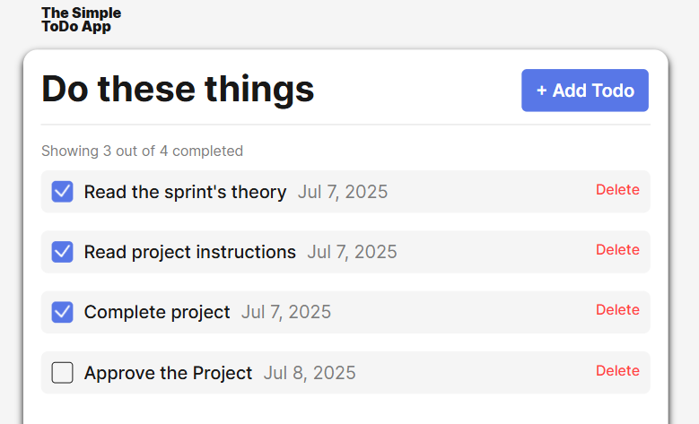

# Simple Todo App

A modern, responsive Todo application built with vanilla JavaScript ES6 modules, demonstrating object-oriented programming principles, component architecture, and clean code practices. This project showcases front-end development skills including DOM manipulation, form validation, responsive design, and modular JavaScript architecture.

## 🚀 Live Demo

[View the live application](https://itsjaydenking.github.io/se_project_todo-app/)

## 📸 Preview



## ✨ Features

### Core Functionality

- **Add Todos**: Create new tasks with optional due dates
- **Mark Complete**: Toggle completion status with visual feedback
- **Delete Tasks**: Remove todos with confirmation dialogs
- **Real-time Counter**: Dynamic display of completed vs. total tasks
- **Form Validation**: Client-side validation with error messaging

### User Experience

- **Responsive Design**: Optimized for desktop, tablet, and mobile devices
- **Accessible UI**: Proper ARIA labels and keyboard navigation support
- **Modern Interface**: Clean, minimalist design with smooth transitions
- **Modal Interactions**: Popup forms with overlay and escape key support

## 🛠️ Technology Stack

### Frontend

- **HTML5**: Semantic markup with accessibility features
- **CSS3**: Modern styling with CSS Grid, Flexbox, and custom properties
- **JavaScript ES6+**: Modular architecture with classes and imports
- **CSS Modules**: BEM methodology for maintainable styling

### Development Practices

- **Object-Oriented Programming**: Class-based component architecture
- **Module System**: ES6 imports/exports for code organization
- **Form Validation**: Custom validation with real-time feedback
- **Responsive Design**: Mobile-first approach with media queries

## 📁 Project Structure

```
├── index.html                 # Main HTML file
├── README.md                  # Project documentation
├── assets/
│   └── screenshot.png         # Project preview image
├── blocks/                    # CSS modules (BEM methodology)
│   ├── button.css            # Button component styles
│   ├── counter.css           # Todo counter styles
│   ├── form.css              # Form element styles
│   ├── header.css            # Header component styles
│   ├── page.css              # Page layout styles
│   ├── popup.css             # Modal popup styles
│   ├── todo.css              # Individual todo item styles
│   └── todos.css             # Todo list container styles
├── components/               # JavaScript modules
│   ├── FormValidator.js      # Form validation logic
│   ├── Popup.js              # Base popup functionality
│   ├── PopupWithForm.js      # Form-specific popup extension
│   ├── Section.js            # List rendering component
│   ├── Todo.js               # Individual todo item component
│   └── TodoCounter.js        # Counter display component
├── images/                   # UI icons and graphics
│   ├── checkbox.svg          # Custom checkbox icon
│   ├── close.svg             # Modal close button
│   └── delete-icon.svg       # Delete button icon
├── pages/
│   ├── index.css             # Main stylesheet imports
│   └── index.js              # Main application entry point
├── utils/
│   └── constants.js          # Configuration and initial data
└── vendor/                   # Third-party resources
    ├── fonts.css             # Inter font family imports
    ├── normalize.css         # CSS reset
    └── fonts/                # Font files (woff2 format)
```

## 🏗️ Architecture

### Component-Based Design

The application follows a modular component architecture:

- **[`Todo`](components/Todo.js)**: Individual todo item with state management
- **[`TodoCounter`](components/TodoCounter.js)**: Real-time counter display
- **[`Section`](components/Section.js)**: List rendering and item management
- **[`PopupWithForm`](components/PopupWithForm.js)**: Modal form handling
- **[`FormValidator`](components/FormValidator.js)**: Input validation and error display

### Key Features Implementation

#### Form Validation

- Custom validation class with configurable rules
- Real-time error messaging and visual feedback
- Submit button state management

#### Responsive Design

- CSS Grid and Flexbox for flexible layouts
- Mobile-first responsive breakpoints
- Touch-friendly interface elements

#### Accessibility

- Semantic HTML structure
- ARIA labels and roles
- Keyboard navigation support
- Screen reader compatibility

## 🚀 Getting Started

### Prerequisites

- Modern web browser with ES6 module support
- Local web server (for CORS compliance with modules)

### Installation

1. **Clone the repository**

   ```bash
   git clone https://github.com/itsjaydenking/se_project_todo-app.git
   cd se_project_todo-app
   ```

2. **Serve the application**

   Using Python:

   ```bash
   python -m http.server 8000
   ```

   Using Node.js:

   ```bash
   npx http-server
   ```

   Using VS Code Live Server extension (recommended for development)

3. **Open in browser**
   Navigate to `http://localhost:8000` (or your server's URL)

## 💻 Usage

### Adding a Todo

1. Click the "+ Add Todo" button
2. Enter a task description (2-40 characters)
3. Optionally set a due date
4. Click "Create" to add the todo

### Managing Todos

- **Complete**: Click the checkbox to mark as done
- **Delete**: Click the delete button and confirm
- **View Progress**: Check the counter for completion status

## 🎨 Customization

### Styling

Modify CSS files in the [`blocks/`](blocks/) directory following BEM methodology:

- `.block` - Component root
- `.block__element` - Component parts
- `.block_modifier` - Component variants

### Configuration

Update [`constants.js`](utils/constants.js) to modify:

- Initial todo items
- Validation rules
- Form selectors

## 🧪 Development

### Code Quality

- ES6+ modern JavaScript syntax
- Consistent code formatting
- Modular architecture with clear separation of concerns
- Semantic HTML with accessibility considerations

### Browser Support

- Chrome 61+
- Firefox 60+
- Safari 10.1+
- Edge 16+

## 📚 Learning Outcomes

This project demonstrates proficiency in:

- **JavaScript ES6+**: Classes, modules, arrow functions, destructuring
- **DOM Manipulation**: Event handling, element creation, dynamic content
- **CSS Architecture**: BEM methodology, responsive design, CSS Grid/Flexbox
- **Form Handling**: Validation, user input processing, error states
- **Component Design**: Reusable, modular code architecture
- **Accessibility**: ARIA attributes, semantic HTML, keyboard navigation

## 🤝 Contributing

1. Fork the repository
2. Create a feature branch (`git checkout -b feature/amazing-feature`)
3. Commit your changes (`git commit -m 'Add amazing feature'`)
4. Push to the branch (`git push origin feature/amazing-feature`)
5. Open a Pull Request

## 📄 License

This project is open source and available under the [MIT License](LICENSE).

## 👨‍💻 Author

**Jordan Campbell**

- GitHub: [@itsjaydenking](https://github.com/itsjaydenking)

---

_Built with ❤️ as part of my web development journey_
